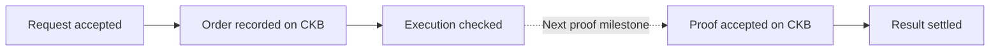
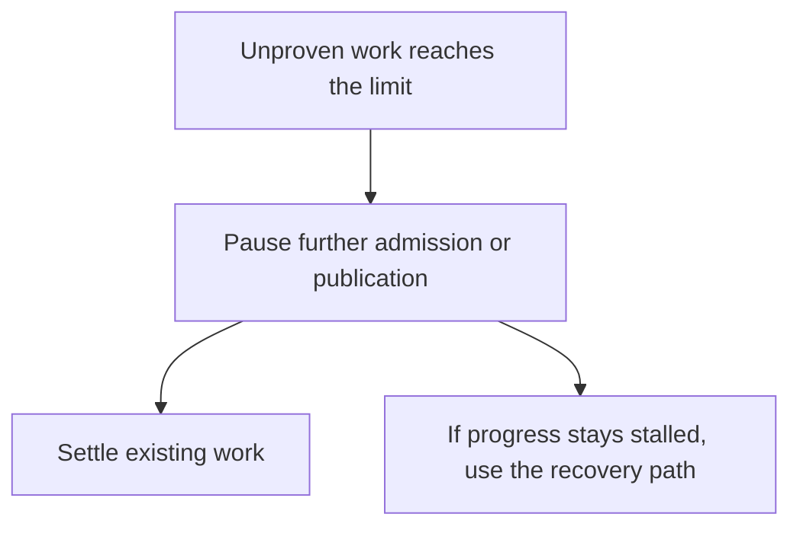
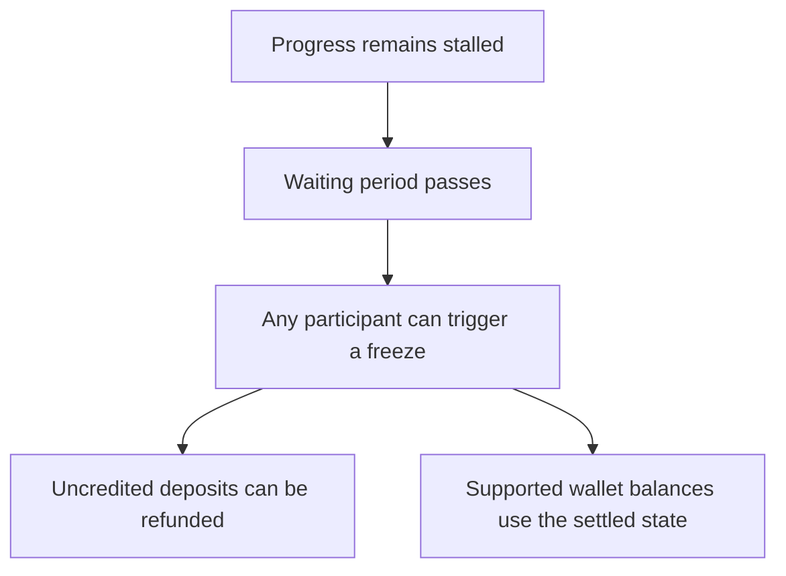

# Tactus 0.02 — making the rollup lifecycle explicit

*26 October 2026 · Development release. Not for public funds.*

Tactus 0.01 explored whether an EVM rollup on CKB could work. In 0.02, the focus is making the different parts agree: how transactions enter the system, what order they follow, when their results can be trusted, and what users can do if progress stops.

The most important distinction is between **being ordered** and **being settled**. A transaction appearing in the rollup’s history does not, by itself, make its result available for withdrawals.

## What changes

Deposits and priority requests now follow explicit queues. Once a batch of work is fixed, later arrivals cannot change what it contains. Publishing progress must respect both queues, rather than advancing one while quietly leaving the other behind.

There are limits on how much work can remain unproven. When those limits are reached, new work pauses. The paths needed to make progress or respond to a stall remain available.

Reports now distinguish ordered work, settled results, claims that are ready to submit, and payments already included on CKB. Each on-chain observation shows its own confirmation depth. A provisional promise is not shown as settled, and a chain reorganization can change previously reported status.

The system also has an explicit response to a prolonged stall. After the required waiting period, another participant can freeze the instance. Freezing stops new progress and preserves the boundary used to determine each person’s rights.

These rights are different. A deposit that has not been credited can be refunded after a freeze. A normal withdrawal must match its recorded request. An emergency wallet claim needs the owner’s authorization and uses the settled balance. The same entitlement cannot be claimed twice. Fees and payment costs come from external funds, rather than reducing the amount the user is owed.

## What we checked

Local CKB networks have exercised full queues, competing submissions, a stalled instance, refunds, node outages and a genuine chain reorganization. Recovery follows the replacement chain and discards rights that existed only on the abandoned branch.

Maximum-size publication transactions were accepted by the local CKB node. The proving program also reproduced the expected results for full backlogs, maximum-size inputs, mixed successful and failed transactions, and heavier computation and signature workloads.

These checks establish execution and protocol behavior. A complete new proof, accepted settlement and the resulting asset release remain the next milestone. We do not yet have an end-to-end proving-speed improvement to announce for 0.02.

## What remains ahead

Shared cells still create competition between submissions, and admission fairness remains an open problem. General emergency exits for assets held by contracts are also unfinished; the wallet exit path does not cover every DeFi position.

Next comes the complete proof-to-settlement demonstration. Later work will reduce repeated proving work and measure performance on suitable proving hardware. A separate RISC-V contract experiment will explore execution choices without holding up the main protocol work.

## Try it

The release includes the protocol implementation, recovery tools, fixed program files and downloadable test evidence. The [getting started guide](https://github.com/Tactus-Labs/tactus-o1/blob/v0.02/specs/V0_02_RELEASE_GUIDE.md) explains how to check the download and run a local development instance.
